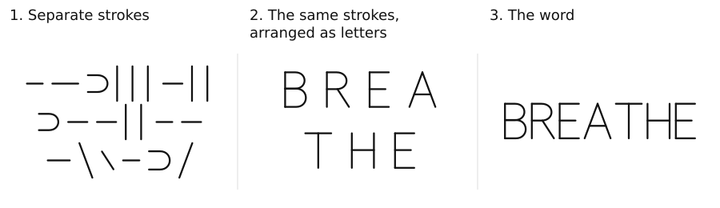

<a href="https://beforeword.xyz/en/"><picture>
  <source media="(prefers-color-scheme: dark)" srcset="https://raw.githubusercontent.com/beforeword/beforeword/main/brand/site-wordmark-dark.png">
  
</picture></a>

# Why are these words about me?

English · [Русский](README.ru.md)

**A public statement by Kirill Shebetov · 8 October 2026**

Someone gives me a name. I can learn to say it. Why should that oblige me to answer to it, or to repeat someone else’s description as my own? This statement examines that demand and proposes five changes.

[Read the statement on Beforeword](https://beforeword.xyz/statement/en/) · [Read the short version](brief.en.md)

## Start with the writing

The same strokes are arranged into letters and then into “BREATHE”. Reading it as an English word requires knowing the marks and their use. **The writing has not become breathing.**

Now add:

> You are breathing.  
> Confirm that this describes you.

A description and a demand for a response have been added. Writing these further lines does not itself justify applying the description or requiring agreement.

The statement examines what is required when words are taught and records are used: describing yourself, answering to a name and affirming a prescribed statement. It asks what grounds are offered for each requirement and proposes changes.

## Five proposed changes

1. Review compulsory teaching requirements. Stop requiring people to affirm prescribed statements in their own name.
2. End the requirement to answer to an assigned name. Examine responding, identifying a record and signing a document separately.
3. Present each demand, its grounds and the authority claimed.
4. Distinguish correcting a record from ending its use.
5. Separate an answer, its assessment and the decision—including for AI.

These are proposals, not rules already in force or conclusions obtained from the letters. The [full statement](statement.en.md) sets out their reasons and limits.

Constructed examples, the author's personal account and passages from documents are identified separately. The [source notes](statement.en.md#materials) explain how each document is used and what it does not establish.

**No word becomes what it describes. Including the words of this statement.**

## Editions and downloads

[Full text](statement.en.md) · [Short text](brief.en.md) · [Full PDF](pdf/statement.en.pdf) · [Short PDF](pdf/brief.en.pdf)

## A related proposal for AI products

[A product’s voice does not define you](product-defaults/proposal.en.md) is a separate proposal dated 23 October 2026. It asks product teams to offer assistance without requiring users to accept a description of themselves or presenting a product as having feelings.

[Русский](product-defaults/proposal.ru.md) · [Sources and limits](product-defaults/sources.md) · [Review criteria](product-defaults/review.md) · [Submission text](product-defaults/submission.en.md)

## Continue the reading

[Read the wider Beforeword proposal](https://beforeword.xyz/proposal/en/) on what would change if nobody had to accept the words and numbers they learn as who they are, who others are or what the world is.

- [“Did You Understand Me?”](https://beforeword.xyz/research/understanding/en/)
- [Reading as Enclosure](https://beforeword.xyz/research/reading-as-enclosure/en/)
- [Self-description and decisions based on records](https://beforeword.xyz/research/words-and-decisions/en/)
- [End imprisonment for words](https://beforeword.xyz/research/words-and-imprisonment/en/)

These studies continue the examination; they are not independent support for the proposals above.

## Respond

[Open a question, objection or correction](https://github.com/beforeword/statement/issues/new/choose). You can quote the passage and explain what you dispute or propose changing. Agreement with the statement is not required. [How to suggest a change](CONTRIBUTING.md).

[mail@beforeword.xyz](mailto:mail@beforeword.xyz) · [License](LICENSE)

[Beforeword on GitHub](https://github.com/beforeword) · [Beforeword website](https://beforeword.xyz/en/)
