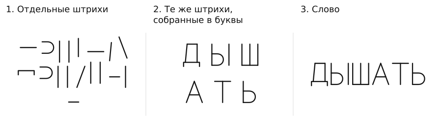

# Почему эти слова — обо мне?

Русский · [English](README.md)

Публичное заявление · Кирилл Шебетов · beforeword · 8 октября 2026

Почему требуется описывать себя выбранными за тебя словами, откликаться на назначенное имя или подтверждать от своего имени чужие утверждения?

**[Читать заявление на сайте →](https://beforeword.xyz/statement/)**

Текст: [Полное заявление](statement.ru.md) · [Краткая версия](brief.ru.md)  
PDF: [Полное заявление](pdf/statement.ru.pdf) · [Краткая версия](pdf/brief.ru.pdf)

## Предложение для ИИ · 23 октября 2026

**[Выбор слов для продукта — не описание тебя](product-defaults/proposal.ru.md)** — предложение о стандартной помощи без выдуманной чувствующей персоны и навязанного самоописания пользователя. [English](product-defaults/proposal.en.md) · [Источники и пределы](product-defaults/sources.md) · [Критерии рассмотрения](product-defaults/review.md) · [Текст обращения](product-defaults/submission.en.md). Это отдельное предложение: исходное заявление и PDF ниже не изменены; внедрение компаниями не заявлено.

## Начать с написания

Одни и те же штрихи собраны сначала в буквы, затем в слово «ДЫШАТЬ». Чтобы прочитать его как русское слово, нужно знать знаки и их употребление. **Написание не стало дыханием.**

Добавим:

> Ты дышишь.  
> Подтверди, что это о тебе.

Добавлены описание и требование ответа. Появление этих строк само не обосновывает ни применение описания, ни требование с ним согласиться.

Заявление разбирает требования, сопровождающие обучение словам и применение записей: описывать себя, откликаться на имя, подтверждать заданное утверждение. Какие основания приводят для каждого требования? Что предлагается изменить?

## Пять предлагаемых изменений

1. Пересмотреть обязательные учебные требования. Прекратить требовать подтверждать заданные утверждения от своего имени.
2. Прекратить требовать отклика именно на назначенное имя. Отдельно рассматривать ответ, сообщение обозначения для поиска записи и подпись.
3. Предъявлять каждое требование вместе с основанием и заявленным полномочием.
4. Различать исправление записи и прекращение её применения.
5. Отделять ответ, его оценку и решение — в том числе для ИИ.

Это предложения, а не уже действующие правила или выводы из букв. Их основания и ограничения рассматриваются в [полном заявлении](statement.ru.md).

Составленные примеры, личный рассказ автора и фрагменты документов обозначены отдельно. В разделе [«Источники»](statement.ru.md#materials) поясняется, для чего приведён каждый документ и какие выводы из него здесь не сделаны.

**Ни одно слово не становится тем, что описывает. Включая слова этого заявления.**

## Продолжить чтение

- [«Ты меня понял?»](https://beforeword.xyz/research/understanding/)
- [«Чтение как клетка»](https://beforeword.xyz/research/reading-as-enclosure/)
- [«Слова о себе и решения по записям»](https://beforeword.xyz/research/words-and-decisions/)
- [«Прекратить лишение свободы за слова»](https://beforeword.xyz/research/words-and-imprisonment/)

Эти работы продолжают разбор; они не представлены как независимое подтверждение предложений выше.

## Для ответа

[Задать вопрос, возразить или предложить исправление](https://github.com/beforeword/statement/issues/new/choose). Можно привести конкретный фрагмент и указать, что оспаривается или предлагается изменить. Согласие с заявлением не требуется. [Как предложить правку](CONTRIBUTING.md).

[mail@beforeword.xyz](mailto:mail@beforeword.xyz) · [Лицензия](LICENSE)
