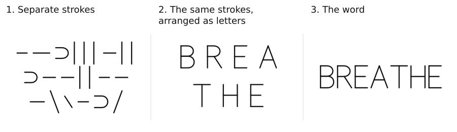

English · [Русский](brief.ru.md) · [Overview](README.md) · [PDF](pdf/brief.en.pdf)

# Why are these words about me?

The same strokes are separated, arranged into letters and assembled into “BREATHE”. Reading it requires learning the marks and their use. **The writing has not become breathing.** Defining it through “air” and “lungs” adds more words.

Four constructed lines:

> fear  
> Fear is a feeling.  
> This is your fear.  
> You must acknowledge that this is your fear.

The second line defines “fear” through “feeling”. The third adds “This is your fear.” The last demands that you accept this as a description of yourself. Adding these lines does not itself justify these steps. The written word “connection” does not become a connection. “Prove that it isn't about you” adds a demand without explaining the original claim. Quoting a line or document allows the added argument to be examined; it does not ask anyone to produce what is named from the letters.

Copying “I BREATHE.” and affirming it about yourself are different tasks. The answers may look identical. **The writing alone does not distinguish acceptance from compliance.**

I was given the name “Кирилл” — Kirill — at birth, then required to answer to it, introduce myself by it and sign documents “Кирилл Шебетов” — “Kirill Shebetov”. I was required to use words translated here as “I”, “breathe”, “want”, “bad” and “good” to describe myself and what was happening. Refusal was not offered. This is a personal account.

The question begins with teaching. Having to teach words first does not explain why these particular words and tasks must be compulsory. Neither the absence of an initial objection nor later command of the words establishes consent after the fact. What must be repeated, done or affirmed, and what happens upon refusal?

Distinguish answering to a name, providing an identifier to find a record and signing a document. In the constructed roll call, presence has already been established, but it is not recorded without the required reply. Removing that condition allows attendance to be recorded without the prescribed response. The example does not establish how widespread the requirement is.

The proposal is to end the requirement to answer to an assigned name and allow refusal without choosing another. The reason is to prevent one side from deciding both how to address someone else and which name that person must answer to. To uphold this limit, the work of changing the procedure should be shared. Organisers would provide another way to address participants or keep records; someone refusing would carry out a separately justified action, such as confirming their presence. Possible delays for others need consideration too. Refusing to answer to a name does not itself solve the task of matching records.

“Harm”, “the price of refusal” and “costs” all remain writing. That applies to this statement's arguments too: the word “costs” does not establish who should bear them. What each side would need to do, and why, must be considered.

The opinion in Corder describes a condition for receiving a diploma: a graduate had to publish an apology containing this sentence:

> I realize that, had I asked ahead of time, I would not have been allowed to say what I did.

The school could state its assessment in its own name. The proposal is to separate receiving the diploma from having to publish this acknowledgment, even if obedience alone is sought.

Five proposed changes:

1. Review compulsory teaching requirements. Stop requiring people to affirm prescribed statements in their own name. Distinguish introducing words, practising their use and requiring someone to describe themselves in those words.
2. End the requirement to answer to an assigned name. Examine requirements to respond, to provide an identifier for finding a record and to sign a document separately; each needs its own grounds.
3. Present each demand, its grounds and the authority claimed. Consider the objection “Why is this about me?” without first demanding proof that what has been named is absent.
4. Distinguish correcting a record from ending its use.
5. Separate an answer, its assessment and the decision—including for AI. “I understand”, “Human”, “AI” and “Checked” do not replace test conditions, results or grounds for further action.

These are proposals, not conclusions derived from letters or a complete replacement for teaching. The full statement sets out their reasons and limits.

**No word becomes what it describes. Including the words of this statement.** Its signature does not become its author; proposing a change does not make it happen.

Kirill Shebetov · beforeword

Full statement, documentary examples and sources:  
https://beforeword.xyz/statement/en/
